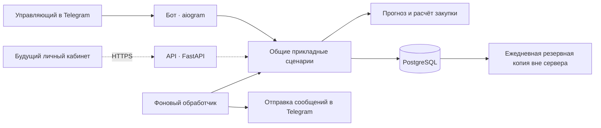

# «Завтра»: предложение по архитектуре и технологиям

Дата: 17.10.2026. Статус: Python утверждён пользователем для MVP; архитектура и остальные технологии — предложение для обсуждения.

Автор проекта: Бакиев Мехроб Мехрзодович. Репозиторий: [MehrobBakiev/Zavtra](https://github.com/MehrobBakiev/Zavtra).

Реализован начальный срез Telegram-бота: aiogram, общие сценарии и чистые расчёты, SQLAlchemy с SQLite для локального запуска и PostgreSQL для сервера. Структура фактического кода описана в [README](../README.md). Диаграмма и разделы ниже описывают целевую архитектуру полного MVP: отдельный worker, расписание, отчёт пилота и API ещё предстоит добавить. Для статистики первого среза используются Decimal и стандартная библиотека; pandas/NumPy остаются возможными инструментами следующего этапа.

Основание: [PRD](2.1_PRD_Zavtra.pdf), [SRS](2.2_SRS_Zavtra.pdf), [User Stories](2.3_UserStories_Zavtra.pdf), [RTM](2.4_RTM_Zavtra.pdf). Дополнение пользователя: сначала Telegram-бот, затем веб-сайт. Навыки команды, сроки разработки и бюджет размещения пока неизвестны.

Решение по языку: пользователь рассматривал Go, но пока изучает его и выбрал Python для MVP. Язык реализации последующих версий отдельно не зафиксирован.

## 1. Основное решение

Предлагается модульный монолит на Python: один репозиторий, общее прикладное ядро, одна PostgreSQL. Бот, фоновый обработчик и будущий HTTP API используют одни и те же сценарии и правила расчёта.

Для пилота приложение запускается двумя процессами: `bot` и `worker`. Они собираются из одного исходного кода. Разделение процессов позволяет рассчитывать прогноз и разбирать файлы, не задерживая ответы бота. Это не требует независимых микросервисов и сетевых вызовов между модулями.

С появлением личного кабинета добавятся процесс API и фронтенд. Если сайт окажется только страницей с описанием продукта, подключать его к базе и API не потребуется.



Диаграмма показывает логические зависимости. Модули приложения обращаются к PostgreSQL через общий слой доступа к данным. Фронтенд напрямую к базе не подключается.

## 2. Предлагаемый стек

| Задача | Технология | Обоснование для проекта |
| --- | --- | --- |
| Прикладная логика | Python — утверждён для MVP | Один язык для бота, расчётов, обработки таблиц и будущего API |
| Telegram | aiogram 3.x | Обработчики сообщений, кнопки, маршрутизация и сценарии диалога |
| Хранение | PostgreSQL | Связанные данные точек, транзакции, ограничения целостности, сохранение заданий |
| Доступ к БД | SQLAlchemy 2.x + psycopg 3 | ORM и асинхронные операции с PostgreSQL |
| Изменение схемы | Alembic | Версионируемые миграции базы |
| Валидация | Pydantic | Проверка входных значений и конфигурации |
| CSV/XLSX | pandas + openpyxl | Разбор выгрузок; openpyxl также для XLSX-отчёта |
| Прогноз и статистика | pandas + NumPy | Группировки по дням недели, бэктест, квантили ошибок |
| Фоновые задания | Отдельный Python worker + таблицы заданий в PostgreSQL | Небольшая нагрузка пилота; задания и попытки сохраняются при перезапуске |
| Будущий HTTP API | FastAPI | Контракт OpenAPI, схемы запросов и ответов; подключается при разработке кабинета |
| Будущий кабинет | React + TypeScript + Vite, предварительно | Формы, таблицы, отчёты; окончательный выбор после определения задач сайта |
| Зависимости | uv + lock-файл | Повторяемая установка конкретных версий |
| Проверки | pytest, Ruff | Приёмочные сценарии, интеграционные проверки БД, форматирование и статический анализ |
| Запуск | Docker Compose на одном VPS | Воспроизводимое окружение для бота, worker и БД |

Точные версии Python и пакетов следует закрепить при создании каркаса после проверки совместимости. Версии в этой таблице обозначают семейства API, а не проверенный набор зависимостей. Производительность и качество прогноза пока не измерялись.

## 3. Границы кода

Предлагаемая структура, каталоги пока не созданы:

```text
src/zavtra/
    bot/              # Команды, кнопки, тексты и сценарии диалога
    api/              # HTTP-маршруты будущего кабинета
    application/      # Сценарии: импорт, остатки, расчёт, подтверждение, отчёт
    domain/           # Правила закупки, ограничения и состояния заказа
    forecasting/      # Модели прогноза, бэктест и метрики
    infrastructure/   # БД, файловые адаптеры, клиент Telegram
    worker/           # Расписание, выполнение заданий и повторные отправки
    config.py
migrations/
tests/
```

Бот получает сообщение, проверяет личность пользователя, преобразует ввод и вызывает прикладной сценарий. Например, `record_stock`, `request_recommendation`, `confirm_order`. API позже вызывает те же сценарии. Боту не требуется делать HTTP-запросы к собственному API.

Расчёт закупки получает подготовленные данные и возвращает результат. Он не зависит от Telegram, FastAPI и способа хранения данных. Проверка доступа выполняется на границе каждого прикладного сценария, включая вызовы из будущего API.

Предметные области внутри приложения: доступ и точки; ингредиенты и техкарты; продажи и импорт; остатки; прогноз и рекомендация; заказы; списания и нехватки; отчёт пилота; расписание и доставка.

## 4. Данные, которые важно заложить сразу

Это логические сущности для следующего этапа проектирования, а не готовая схема таблиц.

| Группа | Содержание |
| --- | --- |
| Пользователи и доступ | Внутренний пользователь, привязанный Telegram ID, членство пользователя в точке, одноразовые коды со сроком 24 часа |
| Точки | Название, часовой пояс IANA, местное время отправки, настройки пилота |
| Справочники | Блюда, ингредиенты, единицы, цены, Cu/Co, кратность заказа, версии техкарт |
| Продажи | Количество по точке, блюду и дате; пакет импорта, ошибки строк, признак полноты дня |
| Остатки | Количество по ингредиенту и рабочей дате, автор, время и версия изменения |
| Расчёты | Дата формирования и дата прогноза, версия алгоритма, снимок входных данных, прогноз, eCR, потребность, рекомендация и предупреждения |
| Заказы | Ссылка на актуальную рекомендацию, рекомендованные и итоговые количества, подтверждение и автор |
| Учёт пилота | Списания, нехватки со временем, полнота дневного учёта, периоды сравнения, цены на начало пилота |
| Фоновая работа | Задания с временем запуска, попытками и сроком блокировки; исходящие сообщения и статусы доставки; журнал событий |

Собственные идентификаторы пользователей позволят позже добавить веб-вход без замены всех ссылок на Telegram ID. Пользователь может состоять в нескольких точках; активная точка выбирается явно.

У всех данных точки есть `point_id`; запросы проверяют членство пользователя в этой точке. Связи и ограничения БД также должны исключать привязку строки заказа или техкарты к ингредиенту другой точки.

Цены, нормы и итоговые количества хранятся как точные десятичные значения (`NUMERIC` / `Decimal`). Статистические вычисления могут использовать `float`, но преобразование результата и округление к упаковке должны быть определены явно. В тестах нужны значения около границы упаковки.

События хранятся с временной зоной и приводятся к UTC; рабочая дата и дата прогноза определяются в часовом поясе точки. Дата ввода остатков и дата закупки — отдельные поля.

## 5. Как проходит вечерний сценарий

1. Управляющий вводит остатки. Бот проверяет доступ и значения; подтверждает сохранение после успешной транзакции БД.
2. После последнего остатка система в той же транзакции создаёт задание расчёта. При неполном вводе называет недостающие ингредиенты.
3. Worker фиксирует согласованный снимок входных данных и рассчитывает прогноз, потребность и заказ.
4. При сохранении результата проверяется версия исходных данных. Если остатки успели изменить, старый расчёт не становится актуальной рекомендацией; выполняется новый.
5. До времени отправки рекомендация хранится в БД. В заданное время создаются задания доставки каждому привязанному аккаунту. Если остатков нет, отправляется напоминание; после позднего ввода рекомендация доставляется в пределах требования 60 секунд.
6. Управляющий корректирует заказ и подтверждает его. Подтверждение проверяет актуальность рекомендации и атомарно сохраняет итоговые количества. Повторное нажатие возвращает уже существующий заказ.
7. После подтверждения количества не редактируются. Старые кнопки не могут подтвердить устаревшую версию рекомендации.

Уникальные ограничения и транзакции защищают от повторного импорта, двойного подтверждения и повторного создания одного задания. Ограничение одного итогового заказа следует привязать к точке и дате, на которую он рассчитан.

## 6. Фоновые задания и надёжность

Для 1–2 точек предлагается небольшая очередь в PostgreSQL. Это компромисс: меньше инфраструктуры, но потребуется самостоятельно реализовать и проверить повторные попытки, захват задания и восстановление после сбоя.

Минимальные поля задания: тип, ключ уникальности, ссылка на данные, `run_at`, статус, число попыток, срок блокировки, последняя ошибка. Worker короткой транзакцией забирает готовые задания через `FOR UPDATE SKIP LOCKED`; затем выполняет работу вне этой транзакции. После сбоя задание возвращается в обработку по истечении блокировки. Изменять состояние задания может только владелец действующей блокировки.

Задания обработки данных и отправки сообщений должны иметь раздельные лимиты выполнения. Синхронный разбор таблиц и длительный расчёт выполняются вне цикла обработки сообщений worker, чтобы не задерживать расписание и повторы доставки. Проверкой TC-11/TC-12 нужно подтвердить, что весь путь после ввода остатков укладывается в ограничения, включая ожидание задания.

Планировщик регулярно проверяет сохранённые настройки точек и создаёт пропущенные задания после перезапуска. Политика отправки после окончания рабочего дня задаётся отдельно: нельзя отправлять вчерашний заказ как сегодняшний. Задания доставки создаются вместе с результатом/изменением состояния в одной транзакции — подход transactional outbox.

При временной недоступности Telegram повторяем отправку с интервалом не более минуты в течение 30 минут, как требует SRS. Ограничения Telegram на частоту запросов обрабатываются отдельно, с записью фактической задержки. После исчерпания повторов остаётся видимая ошибка доставки. Блокировка бота пользователем — отдельная постоянная ошибка.

Внутренние операции делаем идемпотентными. При неопределённом сетевом исходе отправки во внешний Telegram возможен повтор сообщения; архитектура не обещает строгую однократную доставку. Подтверждение заказа при этом всё равно создаёт один итоговый заказ.

Redis и Celery можно добавить при появлении измеримой потребности в нескольких обработчиках и большем потоке заданий. Прикладные сценарии при этом сохраняются, меняется механизм исполнения.

## 7. Прогноз и расчёт закупки

Первый кандидат модели — средние продажи блюда за соответствующий день недели за несколько последних недель. Сравниваем его с простым прогнозом «как в тот же день прошлой недели» через последовательный бэктест, где прогнозируемый день и будущие продажи не входят в обучение. Окончательную модель выбираем по данным пилотной точки; достижение WAPE ≤30% не гарантируется выбором библиотеки.

Модель прогноза порций и правило закупки — разные части. После прогноза выполняется формула FR-06:

```text
потребность = сумма(прогноз порций × норма ингредиента)
CR = ограничить(Cu / (Cu + Co), 0.50, 0.95)
Q = потребность × (1 + квантиль ошибок для CR)
заказ = округлить_вверх_до_кратности(max(0, Q − остаток))
```

Квантили оцениваются по ошибкам прогноза потребности конкретного ингредиента. При недостаточной истории используется надбавка +10% и соответствующая пометка по SRS. В снимке расчёта сохраняются использованные ошибки, параметры модели, метод квантиля, версии библиотек и версия кода. Для воспроизведения сохраняем именно исходные данные расчёта, а не ссылки на изменяемые текущие строки.

Точные количества контрольного примера TC-06 проверяются независимо от качества модели на реальных данных. Нулевой прогноз, отсутствие Cu и отсутствие техкарт требуют отдельных ветвей обработки.

## 8. Запуск и эксплуатация пилота

На первом этапе Docker Compose запускает `bot`, `worker` и `postgres` на одном постоянно работающем сервере. Размер сервера выбирается после прогона данных из TC-11; бюджет и провайдер пока не определены. Постоянный диск сохраняет данные контейнеров, но не заменяет резервную копию.

Для бота достаточно long polling с одним процессом, получающим обновления. Публичный HTTP-входящий порт и домен для этого не нужны. Когда появится сайт, API размещается за HTTPS; способ получения обновлений бота можно менять независимо от сайта.

Ежедневная резервная копия БД отправляется вне основного сервера. До пилота проверяется восстановление на чистом окружении за ≤2 часа. Целевую потерю данных фиксируем как RPO ≤24 часа; неудачная копия должна быть видна команде. В SRS формулировка про потерю «до копии» требует уточнения относительно момента сбоя.

Минимальные эксплуатационные сигналы: состояние bot/worker, просроченные задания, ошибки расчёта, задержки и ошибки доставки, время последней успешной резервной копии. Журнал содержит идентификаторы операций и версии, но не токены и строки загруженных файлов. Доступ команды пилота к данным выполняется через ограниченную административную команду с журналированием.

На первом этапе загруженные файлы разбираются во временном хранилище с ограничением 5 МБ; нормализованные данные и результаты проверки сохраняются в БД. Для XLSX дополнительно ограничиваются объём распаковки и число строк. Ошибка файла до стадии применения не должна менять продажи. Долговременное хранение исходных файлов и срок удаления определяются отдельно, если это понадобится пилоту.

## 9. Порядок реализации

1. Уточнить формат выгрузки и доступность истории, проверить данные пилотной точки. На этой основе утвердить стек и модель доступа.
2. Создать каркас, миграции, точки/пользователей, ингредиенты и техкарты; реализовать импорт с отчётом об ошибках.
3. Сделать вертикальный сценарий: файл продаж → остатки в боте → прогноз → рекомендация → подтверждение → сохранённый заказ.
4. Добавить устойчивое расписание, повторные отправки, защиту от устаревших действий и воспроизводимость расчётов.
5. Реализовать учёт списаний/нехваток, загрузку базы, отчёт пилота, резервирование и необходимые проверки RTM до начала пилота.
6. После бота уточнить задачи сайта, добавить API и веб-интерфейс к существующим сценариям.

Приоритетные проверки: эталон TC-06; замена дат при импорте; атомарное подтверждение при одновременных действиях двух пользователей; изоляция точек; воспроизведение расчёта после изменения техкарт; повтор заданий после сбоя; восстановление резервной копии; корректное различение нулевого и отсутствующего учёта пилота.

## 10. Что уточнить перед фиксацией архитектуры

- Навыки и состав команды, срок ближайшей сдачи, бюджет и доступность сервера.
- Сайт: страница о продукте, отдельный личный кабинет или Telegram Mini App. Общий сервер подходит для кабинета и Mini App, но способы входа и интерфейс различаются.
- Как обновляются продажи ежедневно после первой загрузки. Без свежих продаж бэктест, метрики и прогноз начинают опираться на устаревшие данные; автоматической интеграции с кассой в MVP нет.
- Что означает пропущенный день в выгрузке: нулевые продажи, закрытая точка или отсутствующие данные. Автоматически превращать все пропуски в нули нельзя.
- Как импорт заменяет дату, если часть строк этой даты ошибочна. SRS требует одновременно принимать корректные строки и заменять даты; нужна явная политика, предотвращающая незаметное удаление ранее загруженных продаж.
- Как считать относительную ошибку при нулевом прогнозе и какие дни учитывать в минимуме 14 наблюдений для eCR. Также нужно закрепить метод квантиля.
- Критерий US-06 «при Cu > Co заказ больше» требует уточнения: после округления к упаковке, при достаточном остатке или запасе по умолчанию количества могут совпадать. Монотонность не означает строгое увеличение на всех данных.
- Учёт списаний должен отличать «0, день заполнен» от отсутствия записи. Для G-1/G-4 необходимы правила полноты периодов; неизвестный день нельзя считать днём без потерь.
- WAPE в SRS суммируется по ингредиентам в кг, л и штуках. Такой общий показатель зависит от выбранных единиц; полезно согласовать агрегацию и отдельно выводить ошибки по ингредиентам. Фактические продажи во время стоп-листа также не показывают весь неудовлетворённый спрос.

Эти вопросы уточняют данные и критерии приёмки; они не требуют менять выбранное разделение на бот, общее ядро, worker и будущий API. Действующие PDF этим черновиком не изменяются.

## 11. Проверенные официальные источники

Документация проверена 17.10.2026. Архитектура и выбор компонентов выше — предложение для этого проекта; ссылки подтверждают возможности инструментов.

- [aiogram: long polling и ограничение одного получающего процесса](https://docs.aiogram.dev/en/latest/dispatcher/long_polling.html).
- [FastAPI: OpenAPI и валидация](https://fastapi.tiangolo.com/features/).
- [SQLAlchemy: асинхронный доступ](https://docs.sqlalchemy.org/en/20/orm/extensions/asyncio.html), [psycopg: concurrent operations](https://www.psycopg.org/psycopg3/docs/advanced/async.html), [Alembic: миграции](https://alembic.sqlalchemy.org/en/latest/).
- [PostgreSQL: SELECT и SKIP LOCKED для таблиц очереди](https://www.postgresql.org/docs/current/sql-select.html).
- [pandas: чтение Excel](https://pandas.pydata.org/docs/reference/api/pandas.read_excel.html), [NumPy: методы quantile](https://numpy.org/doc/stable/reference/generated/numpy.quantile.html).
- [Vite: поддерживаемые шаблоны, включая React/TypeScript](https://vite.dev/guide/).
- [Docker Compose](https://docs.docker.com/compose/), [uv: locking and syncing](https://docs.astral.sh/uv/concepts/projects/sync/).
